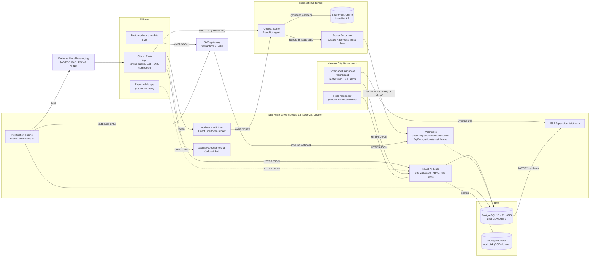
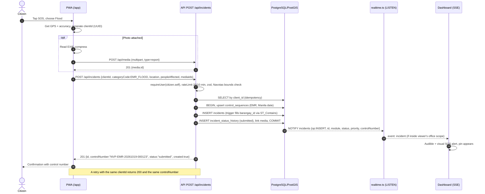
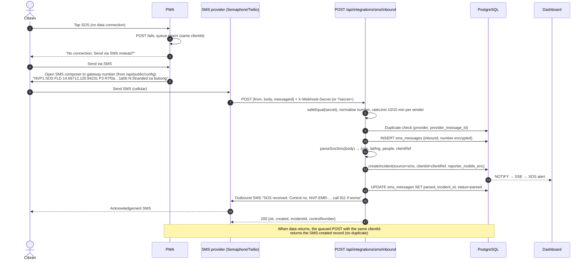
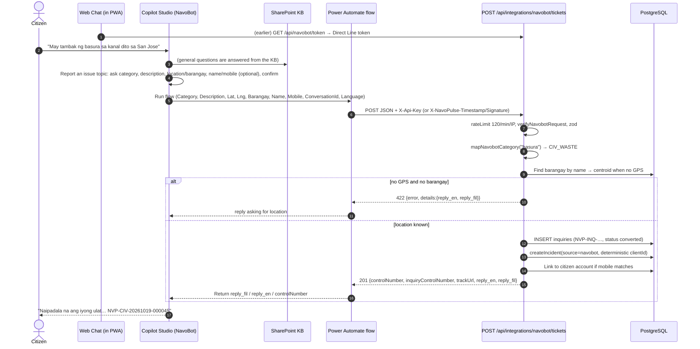
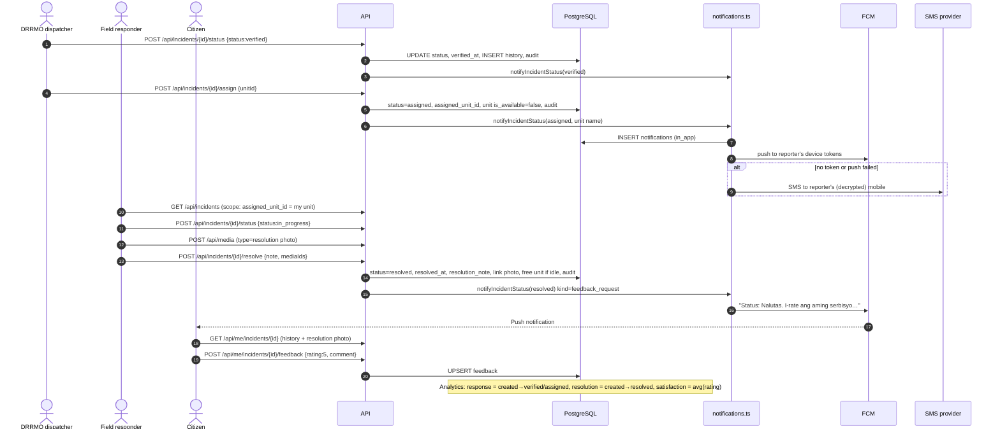
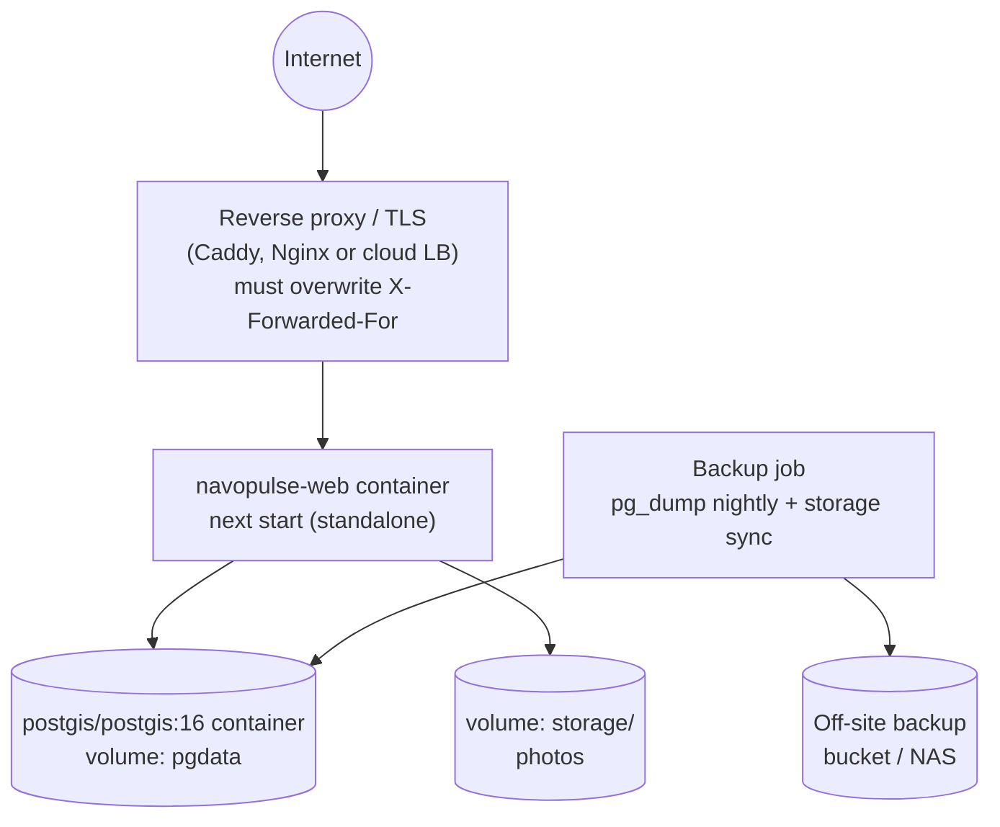

# NavoPulse System Architecture

## 1. Overview

NavoPulse runs as **one Next.js 16 application** (`apps/web`) that serves three surfaces from the same process and the same database:

| Path | Surface | Users |
|---|---|---|
| `/app` | Citizen PWA (installable, offline queue, SMS fallback) | Residents, guests |
| `/dashboard` | LGU Web Command Dashboard | DRRMO, TMO, responders, PIO, super admin |
| `/api` | REST API, webhooks, SSE stream | PWA, dashboard, Power Automate, SMS provider |

Key decisions:

- **PostgreSQL 16 + PostGIS**, schema in raw SQL migrations (`apps/web/db/migrations`). There is no ORM because the most important queries are spatial (`ST_Contains`, `ST_DWithin`, nearest centroid, Voronoi seeding, GeoJSON output).
- **Realtime** = a Postgres trigger (`incidents_notify`) calls `pg_notify('incidents', …)` on every insert or update. One `LISTEN` connection per server process (`src/lib/realtime.ts`) fans events out to every open **Server-Sent Events** stream at `GET /api/incidents/stream`, filtered to what the viewer may see.
- **Providers behind interfaces** chosen by environment variable: `SmsProvider` (console default, Semaphore, Twilio), `PushProvider` (console default, FCM HTTP v1), `StorageProvider` (local disk; an S3/R2/Azure Blob implementation can replace it).
- **NavoBot** lives in Microsoft 365 (Copilot Studio + SharePoint + Power Automate); NavoPulse only exposes a signed webhook and a Direct Line token endpoint.
- The **Expo native app is not built in this iteration**. It appears in the diagram as a future client of the same API; the PWA covers every citizen feature.

## 2. System context and containers



## 3. Code layout

```
navopulse/
├─ apps/web/                     Next.js app: dashboard, PWA, API
│  ├─ db/migrations/001_init.sql Schema, indexes, triggers
│  ├─ scripts/                   migrate.ts, seed.ts, seed-data.ts
│  └─ src/
│     ├─ app/api/**/route.ts     Route handlers (see 06-api.md)
│     ├─ app/dashboard/          LGU dashboard pages
│     ├─ app/app/                Citizen PWA pages (sos, report, reports, chat, …)
│     ├─ components/             UI (IncidentMap, Shell…)
│     ├─ proxy.ts                Redirects /dashboard/* to login without a session cookie
│     └─ lib/
│        ├─ auth.ts  rbac.ts     Sessions, permission matrix, office scope
│        ├─ incidents.ts         Create, scope, workflow, masking
│        ├─ notifications.ts     In-app / push / SMS fan-out
│        ├─ navobot.ts           Webhook auth, category mapping
│        ├─ crypto.ts            AES-256-GCM, lookup hashes, masking
│        ├─ realtime.ts          LISTEN/NOTIFY → SSE
│        ├─ analytics.ts         Summary and export queries
│        └─ providers/           sms.ts, push.ts, storage.ts
├─ packages/shared/src/          constants, zod schemas, controlNumber, smsPayload, i18n
├─ tests/load/incidents.k6.js    Load test
├─ tools/iso25010/compute.py     Survey statistics
└─ docs/                         This documentation set
```

## 4. Request pipeline

Every API route is wrapped by `route()` in `src/lib/http.ts`:

1. `requireUser(req, permission)` resolves the session (cookie `np_session` or `Authorization: Bearer`), checks the session row is not revoked or expired, and checks the permission against `PERMISSIONS` in `rbac.ts`. 401 if not signed in, 403 if not allowed.
2. `rateLimit(key, limit, window)` where applicable (in-memory fixed window; one instance).
3. `parseBody(req, zodSchema)`; zod errors become `400 {error:"Validation failed", details:[{path,message}]}`.
4. Business logic in `src/lib/*`, with **office scoping** (`scopeSql`) on every incident query.
5. `audit()` for administrative actions and PII access.
6. Errors: `ApiError` → its status; anything else → `500 {error:"Internal server error"}` with the stack only in server logs.

## 5. Sequence diagrams

### 5.1 App SOS (online)



### 5.2 Offline SMS SOS



### 5.3 NavoBot ticket



### 5.4 Dispatch → resolve → notify → rate



## 6. Deployment view



Scaling notes: rate limiting is in process memory and the SSE fan-out uses one LISTEN connection per process. Both work with several replicas (each replica listens on its own), but rate limits become per-replica; move them to Redis before scaling horizontally. Local-disk storage must move to an object store or a shared volume before running more than one replica.

## 7. Environments

| Environment | Purpose | Providers |
|---|---|---|
| Local dev | `pnpm dev`, dev secrets default, OTP shown on screen | console SMS/push |
| Staging | Shared integration with Copilot Studio test agent, FCM test project, provider sandbox | `SMS_PROVIDER=semaphore` or `twilio` (test numbers), `PUSH_PROVIDER=fcm` |
| Production | Live city use | Real providers; `NODE_ENV=production` refuses to start without secrets; OTP never exposed unless `NAVOPULSE_DEMO_OTP=1` |
