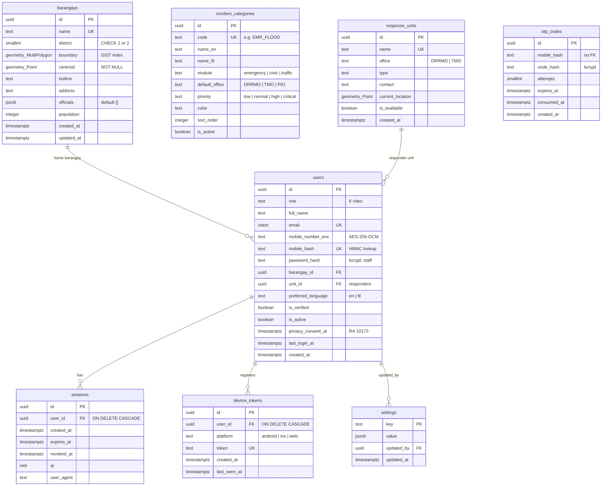
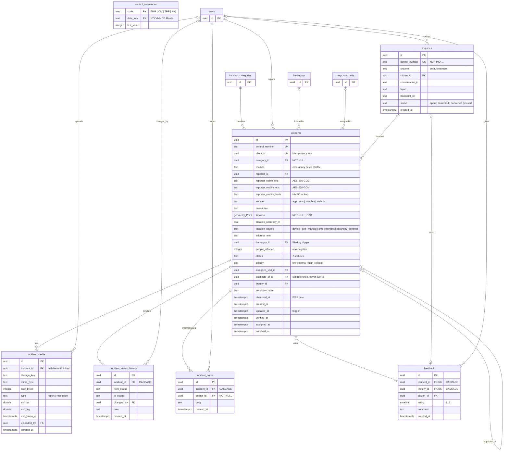
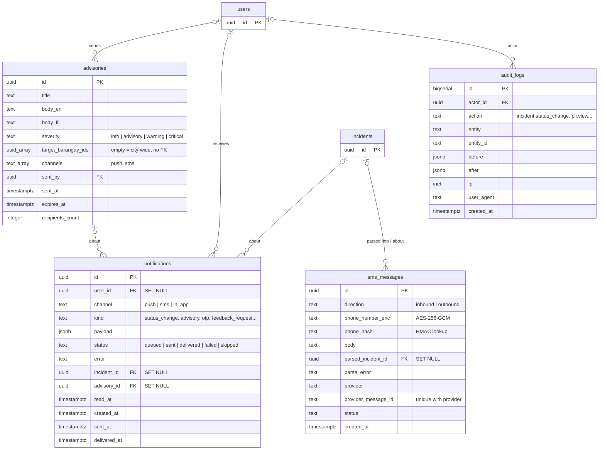
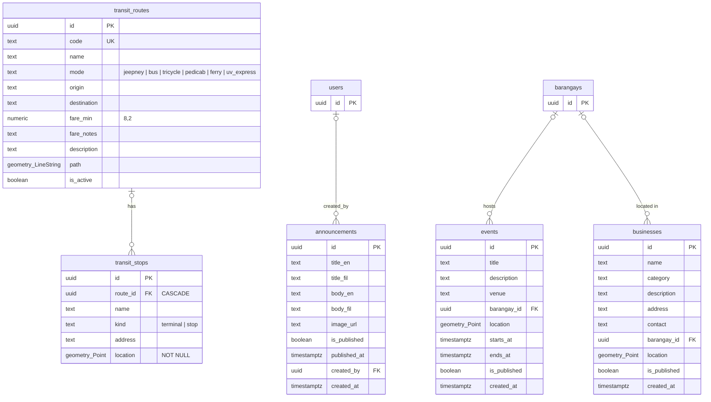
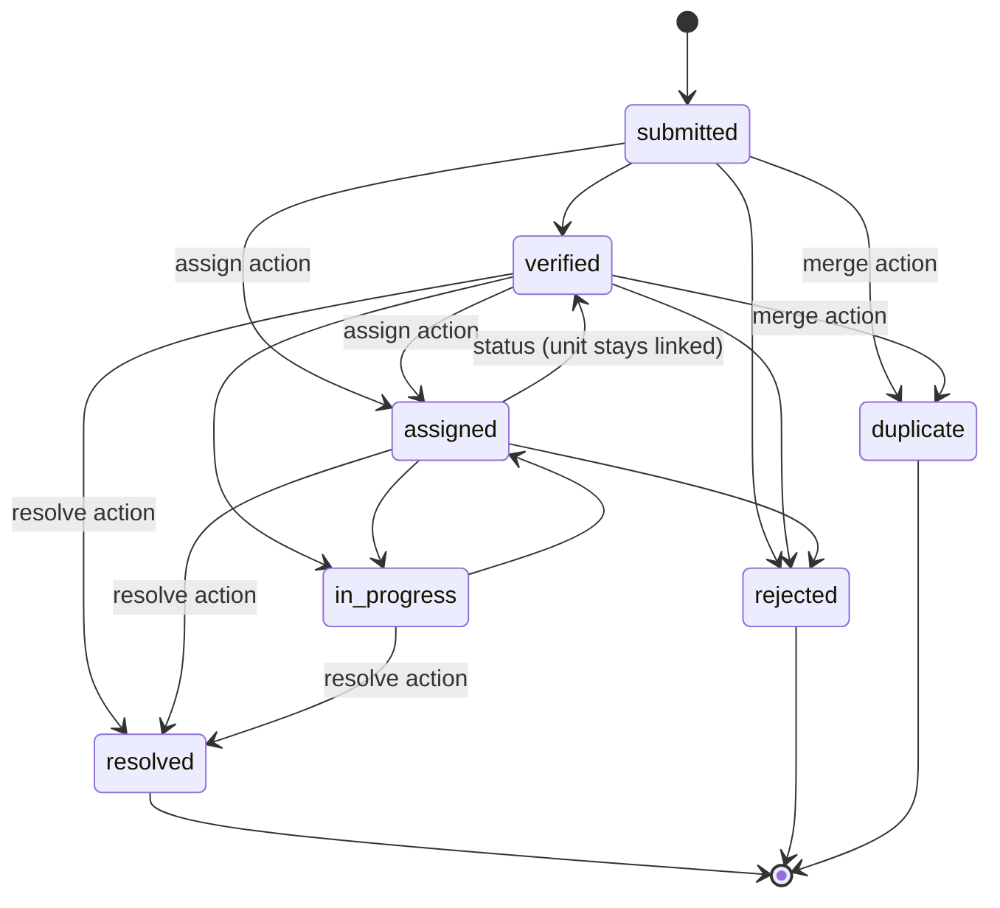

# NavoPulse Data Model

Source of truth: `apps/web/db/migrations/001_init.sql` (PostgreSQL 15+/16 with PostGIS 3, `pgcrypto`, `citext`). The migration runner (`apps/web/scripts/migrate.ts`) also creates `schema_migrations(name, applied_at)` to record applied files.

All geometry is WGS84 (SRID 4326). Primary keys are `uuid DEFAULT gen_random_uuid()` except `audit_logs.id` (`bigserial`), `control_sequences` (composite) and `settings` (`key`).

Mermaid type names cannot contain parentheses, so `geometry(Point, 4326)` is written `geometry_Point`, `uuid[]` is `uuid_array`, and so on.

## 1. Reference and identity

## 2. Incidents and inquiries

## 3. Alerts, messaging and audit

## 4. Content (Angat Navotas, Transport Hub)

## 5. Differences from the spec's starting model

| Spec | Implemented | Why |
|---|---|---|
| `users.mobile_number` | `mobile_number_enc` + `mobile_hash` | Encryption at rest with lookup by keyed hash (RA 10173) |
| `incidents.location geography(Point)` | `geometry(Point, 4326)`; casts to `::geography` for metre distances | GiST on geometry serves both bbox and `ST_Contains`; geography cast only where distance in metres is needed |
| `incident_media.url` | `storage_key` + `mime_type` + `size_bytes`; served by `GET /api/media/{id}` with access checks | Photos are never public URLs |
| — | `incidents.client_id` (unique) | Idempotent creation from offline queue, SMS and NavoBot |
| — | `incidents.module`, `location_source`, `location_accuracy_m`, `observed_at`, `assigned_at`, `inquiry_id`, `resolution_note` | Workflow, analytics and GPS-precision testing |
| — | `reporter_name_enc`, `reporter_mobile_enc`, `reporter_mobile_hash` | Reporters without accounts (SMS, NavoBot, walk-in) |
| — | `sessions`, `otp_codes`, `control_sequences`, `incident_notes`, `settings` | Auth, control numbers, internal notes, config |
| `advisories.target` / `channels` | `target_barangay_ids uuid[]` (empty = all), `channels text[]` | Simple array filters |
| `notifications` | Adds `kind`, `error`, `incident_id`, `advisory_id`, `read_at` | Notification log and in-app inbox |
| `sms_messages` | Adds `phone_hash`, `parse_error`, `provider` | Dedup and troubleshooting |

## 6. PostGIS columns and indexes

| Table.column | Type | Index | Used by |
|---|---|---|---|
| `barangays.boundary` | `geometry(MultiPolygon,4326)` | `barangays_boundary_gix` GiST | Trigger `ST_Contains` lookup; map overlay (`ST_AsGeoJSON(boundary, 6)`) |
| `barangays.centroid` | `geometry(Point,4326)` NOT NULL | none (18 rows) | Nearest-centroid fallback (`ST_DWithin` 1.5 km, `<->` ordering); NavoBot barangay-only tickets |
| `incidents.location` | `geometry(Point,4326)` NOT NULL | `incidents_location_gix` GiST | Map feed (`ST_X/ST_Y`), possible-duplicate search (`ST_DWithin(::geography, 150)`), heatmap |
| `response_units.current_location` | `geometry(Point,4326)` | none | Units layer |
| `events.location`, `businesses.location`, `transit_stops.location` | `geometry(Point,4326)` | none | Map pins in PWA |
| `transit_routes.path` | `geometry(LineString,4326)` | none | Route lines (`ST_AsGeoJSON(path, 6)`) |

Points are built as `ST_SetSRID(ST_MakePoint(lng, lat), 4326)`; note longitude first.

Seeded boundaries are **generated**: `ST_VoronoiPolygons` over the 18 approximate centroids, clipped to a rough city outline (`scripts/seed.ts`). They are for demonstration only. Replace them with official PSA/NAMRIA boundaries before production. (`seed-data.ts` mentions `scripts/import-boundaries.ts`, but that script does not exist yet.)

Non-spatial indexes on `incidents`: `status`, `created_at DESC`, `(module, status)`, `barangay_id`, `reporter_id`, partial `assigned_unit_id WHERE NOT NULL`. Others: `sessions(user_id)`, `otp_codes(mobile_hash, created_at DESC)`, `incident_media(incident_id)`, `incident_status_history(incident_id, created_at)`, `advisories(sent_at DESC)`, `notifications(user_id, created_at DESC)`, `notifications(created_at DESC)`, unique partial `sms_messages(provider, provider_message_id) WHERE provider_message_id IS NOT NULL`, `audit_logs(created_at DESC)`, `audit_logs(entity, entity_id)`.

## 7. Encryption: `_enc` and `_hash` columns

Implemented in `apps/web/src/lib/crypto.ts`, key from `DATA_ENCRYPTION_KEY` (32 bytes, base64).

| Column | Content |
|---|---|
| `users.mobile_number_enc`, `incidents.reporter_name_enc`, `incidents.reporter_mobile_enc`, `sms_messages.phone_number_enc` | AES-256-GCM ciphertext, format `v1.<iv b64url>.<auth tag b64url>.<ciphertext b64url>`, random 96-bit IV per value |
| `users.mobile_hash`, `incidents.reporter_mobile_hash`, `sms_messages.phone_hash`, `otp_codes.mobile_hash` | `HMAC-SHA256(key, "lookup:" + E.164 number)` hex; lets the app find a user by number, link SMS/NavoBot reports to accounts, and deduplicate, without storing plaintext |
| `otp_codes.code_hash`, `users.password_hash` | bcrypt (cost 8 for OTP, 12 for staff passwords set by admin, 10 in seed) |

Notes and limits:
- The same key encrypts and derives lookup hashes. Rotating it needs a re-encryption script (not built); see `12-runbook.md`.
- `users.full_name`, `incidents.description` and `address_text` are **not encrypted** (they are needed for search/display). Descriptions can contain personal data written by the citizen; treat database backups as confidential.
- Seeded walk-in/SMS reporters get `reporter_mobile_enc` but no `reporter_mobile_hash` (seed shortcut; real code paths set both).

## 8. Triggers and functions

| Trigger | Table / timing | Function | Behaviour |
|---|---|---|---|
| `incidents_notify` | `incidents` AFTER INSERT OR UPDATE, per row | `notify_incident_change()` | `pg_notify('incidents', {op, id, module, status, priority, controlNumber})`. Consumed by `src/lib/realtime.ts` → SSE. Payload contains no personal data. |
| `incidents_touch` | `incidents` BEFORE UPDATE | `touch_updated_at()` | Sets `updated_at = now()` |
| `incidents_barangay` | `incidents` BEFORE INSERT | `incidents_fill_barangay()` | When `barangay_id` is NULL: first barangay whose boundary `ST_Contains` the point; else nearest centroid within 1.5 km (points on the bay); else stays NULL ("Unknown" in analytics) |

## 9. Control numbers

`control_sequences(code, date_key, last_value)` holds one counter per prefix per Manila date. `nextControlNumber()` (`src/lib/controlNumbers.ts`) runs an `INSERT … ON CONFLICT DO UPDATE SET last_value = last_value + 1 RETURNING last_value` inside the incident transaction, which row-locks the counter so concurrent reports get distinct numbers. Format and parser: `packages/shared/src/controlNumber.ts` (`/^NVP-(EMR|CIV|TRF|INQ)-(\d{8})-(\d{6})$/`). Sequences above 999,999 per prefix per day throw an error.

## 10. Status workflow

Defined in `STATUS_TRANSITIONS` (`packages/shared/src/constants.ts`). `assigned`, `duplicate` and `resolved` can only be reached through their dedicated endpoints (assign, merge, resolve) so the unit, original case and resolution note are always recorded. Each transition writes `incident_status_history` and the matching timestamp (`verified_at`, `assigned_at`, `resolved_at`, first time only). Note: `constants.ts` mentions reopening by a super admin, but no reopen path is implemented.
