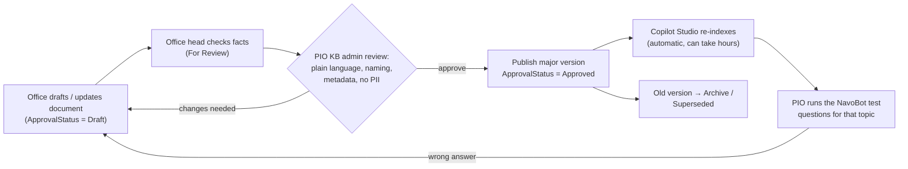

# NavoBot Knowledge Base on SharePoint Online

NavoBot (Copilot Studio) answers **only** from this knowledge base. Its quality is the quality of these documents. The PIO owns the site; each office owns the content in its own library.

> Status: this is the recommended design. Nothing here is created automatically by the NavoPulse code. The PIO or IT creates the site in the city's Microsoft 365 tenant. Do not load sample or invented content (officials, hotlines, fees, evacuation centers) into the live site; every document must come from an official, approved city source.

## 1. Site

| Setting | Value |
|---|---|
| Site type | SharePoint **Communication site** (not a Teams site: fewer stray files, cleaner permissions) |
| Name / URL | `NavoBot Knowledge Base` / `https://<tenant>.sharepoint.com/sites/NavoBotKB` |
| Language | English (content may be English or Filipino; see metadata) |
| Owners | PIO KB administrators (2 people minimum) |
| Members (edit) | Content editors per office, granted per library, not site-wide |
| Visitors (read) | The Copilot Studio maker/service account. Do **not** grant "Everyone except external users" unless every document is meant to be public. |
| External sharing | Off |

Why a dedicated site: Copilot Studio can only answer from what the signed-in agent identity can read, and you want NavoBot to index public-facing content only. Keeping it separate from internal office sites prevents memos, personnel files or drafts from being indexed.

## 2. Document libraries

One library per topic area. Each maps to one Copilot Studio knowledge source, so you can switch an area off without touching the others.

| Library (internal name) | Contents | Content owner | Review cycle |
|---|---|---|---|
| `CitizensCharter` | Citizen's Charter per office (services, requirements, steps, fees, processing time, person in charge) | PIO with each office | Yearly + whenever the Charter is amended |
| `PermitsLicenses` | Business permit (new/renewal), building, occupancy, mayor's permit, cedula, barangay clearance referrals, working permits; checklists and FAQs | BPLO, City Engineering, Treasurer | Before each registration season (Jan) and on change |
| `FloodProtocols` | Tidal flood and high-tide protocols, storm-surge and typhoon response, evacuation procedures, evacuation-center list, what-to-bring lists, pump-station and floodgate FAQs | City DRRMO | Before rainy season (May) + after every activation |
| `BarangayDirectory` | One page/document per barangay (18): hall address, office hours, hotline, officials, map link | PIO with barangays | Quarterly + after barangay elections |
| `TransitGuides` | Routes, terminals, fares (with ordinance/LTFRB reference), ferry schedules, route guides "how to get to…" | TMO | Quarterly + on fare change |
| `CityServicesFAQ` | Other common questions: scholarship, senior/PWD ID, solo parent ID, health center hours, garbage collection schedule | PIO | Quarterly |
| `Archive` | Superseded documents (not a knowledge source) | PIO | — |

Optional: a **Site Pages** library of short FAQ pages written by the PIO in plain language. Pages index very well because they are clean HTML.

### 2.1 Folder layout (inside each library)

Keep it shallow (at most two levels). Example for `FloodProtocols`:

```
FloodProtocols/
├─ Protocols/          (tidal flood, storm surge, typhoon, pre-emptive evacuation)
├─ EvacuationCenters/  (official list, one doc per district + city-wide list)
└─ Preparedness/       (go-bag list, flood safety tips, pump station FAQ)
```

`BarangayDirectory/` holds 18 files directly, no folders.

## 3. Metadata columns

Create these as **site columns** (Site settings > Site columns) and add them to every library, so filters and views are consistent.

| Column | Type | Values / rule | Purpose |
|---|---|---|---|
| `Title` | Single line (built-in) | Plain-language title, e.g. "Business Permit Renewal Requirements 2027" | Copilot shows titles as citations |
| `KBTopic` | Choice | Citizen's Charter, Permits and Licenses, Flood and Evacuation, Barangay Directory, Transit, City Services | Grouping and views |
| `Office` | Choice | PIO, DRRMO, TMO, BPLO, City Engineering, Treasurer, CHO, CSWDO, Barangay | Who to contact; shown in answers |
| `Barangay` | Choice (multi) | the 18 barangays, plus "City-wide" | Barangay-specific docs |
| `Language` | Choice | English, Filipino, Bilingual | Pair documents across languages |
| `Audience` | Choice | Residents, Business owners, Commuters, All | Content targeting |
| `EffectiveDate` | Date | Date the content takes effect | Answer freshness |
| `ReviewDue` | Date | EffectiveDate + review cycle | Stale-content view |
| `SourceReference` | Single line | Ordinance no., memo no., Charter edition | Traceability |
| `ApprovalStatus` | Choice | Draft, For Review, Approved, Superseded | Only Approved is visible to NavoBot |
| `Keywords` | Multiple lines (plain) | Taglish synonyms: "cedula, community tax certificate, CTC" | Improves retrieval for local terms |
| `ContentOwner` | Person | Accountable officer | Review reminders |

Enable **content approval** (Library settings > Versioning settings > Require content approval) and **major versions**. Drafts and minor versions are then hidden from readers, including the agent's account, so NavoBot only sees approved major versions.

## 4. Naming conventions

Pattern: `<Topic>_<Subject>_<Barangay-or-City>_<Lang>_<YYYY-MM>.<ext>`

| Example | Meaning |
|---|---|
| `Permits_BusinessPermitRenewal_City_EN_2027-01.docx` | City-wide business permit renewal checklist, English, effective Jan 2027 |
| `Permits_BusinessPermitRenewal_City_FIL_2027-01.docx` | Filipino version of the same |
| `Flood_EvacuationCenters_District1_BIL_2027-05.docx` | District 1 evacuation centers, bilingual |
| `Brgy_Directory_TangosNorth_BIL_2027-03.docx` | Barangay Tangos North directory page |
| `Transit_Route_NavotasDivisoria_EN_2027-02.docx` | Jeepney route guide |
| `Charter_CityTreasurer_EN_2026-12.pdf` | Citizen's Charter section of the Treasurer's Office |

Rules:
- No spaces or special characters (`&`, `#`, `%`, `ñ` → `n`) in file names; use PascalCase words separated by `_`.
- The **Title** column is the human-readable title; the file name is for sorting.
- One subject per document. Do not merge "all permits" into one 80-page file; retrieval works best on focused documents of 1 to 10 pages.
- When a document is replaced, move the old one to `Archive` (or set `ApprovalStatus = Superseded`) on the same day. Two conflicting versions in the index is the most common cause of wrong answers.

## 5. Writing documents that index well

Copilot Studio splits documents into passages and retrieves the most relevant ones. To help it:

1. **Prefer .docx and SharePoint pages over scanned PDFs.** Scanned PDFs without a text layer are invisible to the index. If only a scan exists, run OCR and check the text.
2. **Use real headings** (Heading 1/2/3 styles), one question or service per heading: "Requirements for a new business permit", "Saan ang evacuation center sa Tanza 1?".
3. **Put the answer in the first sentence under the heading**, then details.
4. **Tables:** keep them simple (no merged cells). Fees and requirement lists work best as bulleted lists or two-column tables.
5. **Write dates, times and places in full** ("June 1, 2027", "8:00 AM to 5:00 PM, Monday to Friday", "Navotas City Hall, M. Naval St., San Jose").
6. **Bilingual:** either one bilingual document (English section then Filipino section with matching headings) or two documents with the same `Title` plus `[EN]` / `[FIL]`. Add common Taglish terms in `Keywords` and in the text ("cedula (community tax certificate)").
7. **Name the office and contact** at the end of each section, using numbers confirmed by that office.
8. **Never include personal data** of private individuals (complainants, beneficiaries, staff mobile numbers). Official office hotlines and the names/positions of elected officials are fine when the city has published them.
9. **Flood and evacuation documents must say what they are not.** Example first line: "This page lists the official evacuation centers. It does not announce evacuations. During an emergency, follow the advisory issued by the City DRRMO." Live conditions (current tide, current flood level, active evacuations) belong in NavoPulse advisories, not in the KB.

## 6. Content-owner workflow



Service levels (proposed):

| Change type | Publish within |
|---|---|
| Emergency correction (wrong hotline, wrong evacuation center) | Same day; also temporarily disable the affected knowledge source if a wrong answer could cause harm |
| Fee/requirement change | 3 working days before it takes effect |
| Routine review | By `ReviewDue` |

A Power Automate scheduled flow can email `ContentOwner` when `ReviewDue` is within 14 days (optional, not built).

## 7. Copilot Studio indexing tips

- Add each library as a **separate SharePoint knowledge source** (Knowledge > Add knowledge > SharePoint > paste the library URL). Name sources clearly ("Flood protocols (DRRMO)").
- Add the **library** URL, not the whole site, so `Archive` and Site Assets are excluded.
- Supported formats change over time; check the current Copilot Studio documentation. As a rule, .docx, .pptx, text-based .pdf and modern SharePoint pages work; images inside documents are not read.
- Large files and very large libraries are indexed slowly or partially; keep each document focused.
- The agent answers with the **permissions of its authentication**. For a public, unauthenticated web chat, use a knowledge configuration that does not depend on the end user's Microsoft account (for example, uploading approved files directly as agent knowledge, or Dataverse-backed SharePoint sync if available in your tenant), and keep the source library limited to public content. Check the current Copilot Studio options for anonymous channels before go-live; this determines whether SharePoint is queried live or synchronized.
- After a large update, test with the questions in `05-navobot-copilot-studio.md` §8 before announcing it.
- Keep **one source of truth per fact**. If the barangay directory lives both in SharePoint and in the NavoPulse database (`barangays` table, edited in the dashboard), decide which is authoritative (recommended: the dashboard; publish a weekly export to the `BarangayDirectory` library) and note it in the document footer.

## 8. Starter checklist

- [ ] Site created, owners assigned, external sharing off
- [ ] Seven libraries created with content approval and major versions
- [ ] Site columns created and added to all libraries; default views show `ApprovalStatus`, `ReviewDue`
- [ ] View "Stale content" (ReviewDue < Today) created in each library
- [ ] Citizen's Charter sections uploaded and approved
- [ ] Official evacuation-center list obtained from DRRMO in writing
- [ ] 18 barangay pages with numbers confirmed by each barangay
- [ ] Transit fares with ordinance/LTFRB reference
- [ ] Knowledge sources added in Copilot Studio; test script passed
